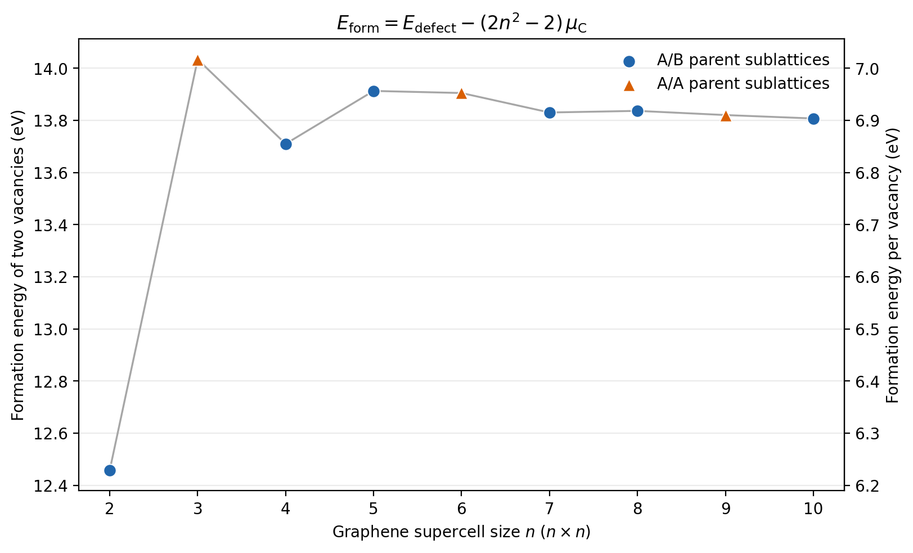

# Local calculation 04: two-vacancy formation energy, 2 x 2 through 10 x 10

Nine fixed-cell graphene calculations, with two vacancies forming the same exact
honeycomb vacancy superlattice as the earlier sets. The supercell repeat size is
`n = 2, 3, ..., 10`; the number of surviving carbon atoms is `N_C = 2*n**2 - 2`.

## Energy definition

The carbon reference is a single-point calculation on the perfect two-carbon
graphene primitive unit cell, using the same MACE-MPA-0 medium checkpoint,
lattice constant 2.46 Angstrom, 15 Angstrom vacuum per side, in-plane periodicity,
CPU and float64 as every defect calculation:

```text
mu_C = E_perfect_unitcell / 2
E_form(two vacancies) = E_relaxed_defect - N_C * mu_C
                     = E_relaxed_defect - E_perfect_supercell + 2 * mu_C
E_form(per vacancy) = E_form(two vacancies) / 2
```

The primary reported value is the total formation energy of both vacancies in
one periodic cell. Dividing by two gives an average per vacancy in that array.
The reference cell stays at the prescribed lattice constant; its internal
forces are checked. Perfect supercells at every size are also evaluated to
verify `E_perfect_supercell = 2*n**2 * mu_C` within 1e-7 eV.

## Vacancy placement and relaxation

Vacancies lie at full-cell fractional coordinates `(0, 0)` and `(2/3, 1/3)`
when `n % 3 == 1`, or `(1/3, 2/3)` otherwise. These are actual carbon sites.
Explicit 7 x 7 repetitions check all 50 interior vacancy sites per size for
three equal nearest distances `n*a/sqrt(3)` and 120-degree angles.
See `vacancy_geometry_check.json` for indices, coordinates and numerical checks.

Sizes 3, 6 and 9 use parent sublattices A/A; all other sizes use A/B. The scan
therefore changes vacancy separation, concentration and parent-sublattice
arrangement. The 2 x 2 case removes 25% of the original carbon sites.

The relaxation protocol matches sets 02 and 03: fixed cell vectors, all atomic
coordinates free in 3D, ASE BFGS, maximum step 0.1 Angstrom, and maximum force
below 0.005 eV/Angstrom. Initial Gaussian perturbations have standard deviation
0.01 Angstrom and seed `20261010 + n`, with their mean translation removed.
These are single-start local relaxations.

## Reproduction

From the paper directory:

```sh
OPENBLAS_NUM_THREADS=4 OMP_NUM_THREADS=4 VECLIB_MAXIMUM_THREADS=4 \
  /opt/anaconda3/envs/mace/bin/python calculations/04_vacancy_formation_energy_2_10/relax.py
/opt/anaconda3/envs/mace/bin/python calculations/04_vacancy_formation_energy_2_10/plot_formation_energy.py
```

The plotting script calls `plt.show()` by default and exports PNG, SVG and PDF.
Use `--no-show` for export only. Its main axis shows the formation energy of
both vacancies; the right axis shows the average per vacancy. Marker shapes
identify the parent sublattices, and the joining line is a guide to the eye.

Use `relax.py --sizes 4 5` to select cases and `--resume` for an interrupted run.
Converged results with matching settings are retained and their formation
energies re-extracted. Each extracted energy is checked with a fresh MACE
evaluation of the saved relaxed structure and the equivalent standard formula.

`perfect_unitcell/` contains the carbon reference. Each `nxn/` directory
contains its inputs, relaxed structure, log, trajectory, restart, displacement
data, relaxation metrics and `formation_energy.json`. The combined records are
`formation_energies.csv` and `formation_energies.json`. Model provenance and
environment versions are recorded separately. The pinned checkpoint is reused
from `../02_vacancy_relaxation/.models/`.

## Results

The perfect-unit energy is -18.4076241301 eV for two carbons, giving
`mu_C = -9.2038120651 eV/C`. Its maximum internal force is
9.785e-15 eV/Angstrom. All nine defect cells converged.

| Cell | Carbon atoms | Parent sublattices | Formation energy, two vacancies (eV) | Per vacancy (eV) | Max force (eV/Angstrom) |
|---|---:|---|---:|---:|---:|
| 2 x 2 | 6 | A/B | 12.457795 | 6.228898 | 0.004598 |
| 3 x 3 | 16 | A/A | 14.034173 | 7.017087 | 0.003820 |
| 4 x 4 | 30 | A/B | 13.710196 | 6.855098 | 0.003587 |
| 5 x 5 | 48 | A/B | 13.913360 | 6.956680 | 0.004394 |
| 6 x 6 | 70 | A/A | 13.905304 | 6.952652 | 0.004589 |
| 7 x 7 | 96 | A/B | 13.830592 | 6.915296 | 0.004525 |
| 8 x 8 | 126 | A/B | 13.836803 | 6.918401 | 0.004933 |
| 9 x 9 | 160 | A/A | 13.820776 | 6.910388 | 0.003818 |
| 10 x 10 | 198 | A/B | 13.807627 | 6.903813 | 0.004746 |

The largest perfect-supercell extensivity residual is 2.956e-12 eV.
The formation energies for 7 x 7 through 10 x 10 span 13.8076-13.8368 eV for
both vacancies (6.9038-6.9184 eV per vacancy). This small spread describes these
force-converged structures; it does not establish the global-minimum vacancy
reconstruction or a dilute-vacancy limit.


