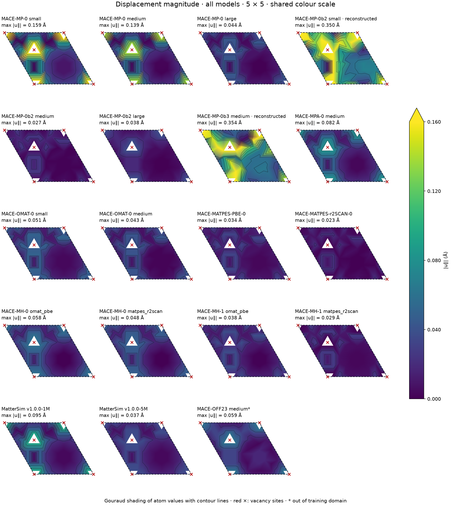
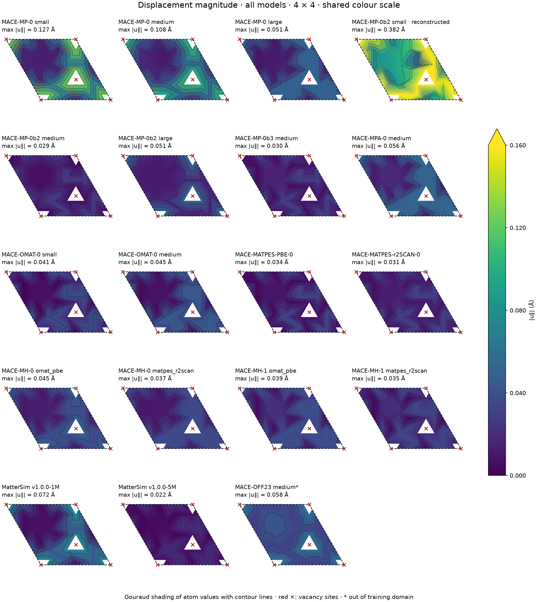
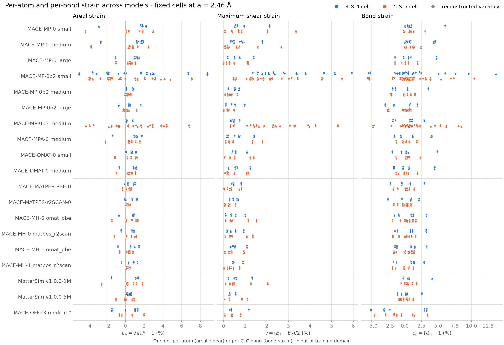

Comparison of machine-learned interatomic potential (MLIP) foundation models on
the graphene vacancy calculations. The first comparison repeats the
calculation 02 relaxation of two-vacancy 4 × 4 and 5 × 5 cells with 19 model
configurations and compares the resulting displacement and strain fields. The
[calculation README](README.md) records the method, files and reproduction
commands.

## 4 × 4 and 5 × 5 relaxations across models

Every model configuration starts from the same coordinates as calculation 02:
fixed cells at $a = 2.46$ Å with 15 Å vacuum per side, vacancies at original
indices (0, 19) and (0, 17), the same 0.01 Å Gaussian perturbation, and ASE BFGS
to a maximum force below 0.005 eV/Å. MACE models run in float64 and MatterSim
in float32. MACE-MH-0 and MACE-MH-1 each run with their `omat_pbe` and
`matpes_r2scan` heads.

All 38 relaxations converged, and a fresh evaluation of each saved structure
reproduced its energy and forces. The MACE-MPA-0 runs reproduce calculation 02
exactly: relaxed positions agree to 0 Å and energies to $6\times10^{-14}$ eV.
MACE-MP-0b2 small in the 5 × 5 cell needed one intervention: BFGS stalled at
step 1000 with a maximum force of 0.151 eV/Å and the energy constant to
$10^{-6}$ eV. A finite-difference check confirmed that the force is the energy
gradient, and a restart from the last frame with a fresh Hessian converged
after 46 further steps.

### Displacement maps by model

These are the Gouraud-shaded displacement-magnitude maps from
[Figure 1](../fig1_strain/notes.qmd), drawn the same way for every model:
$\lvert\mathbf{u}_\parallel\rvert$ at the atoms, interpolated across the
triangulated lattice, with contour lines. Use the menu, the buttons or the left
and right arrow keys to move between models.

The shared scale, 0–0.16 Å, is the same for every model, so colours compare
directly. It covers every run that keeps a symmetric vacancy; the three
reconstructed runs exceed it and saturate. The model's own scale runs from zero
to that model's largest displacement, as in Figure 1, and for MACE-MPA-0 it
reproduces the Figure 1 plot.

::: {.column-page}

:::

### All models at a glance

The same maps for every model on the shared scale.

::: {.panel-tabset .column-page}

#### 5 × 5

#### 4 × 4

:::

In every run with a symmetric vacancy the displacement field has the same
shape: the largest displacements are at the three vacancy neighbours, and the
field falls to near zero at the centre of the largest hexagonal region. Its
amplitude differs by a factor of about seven between models, from 0.023 Å
(MACE-MATPES-r2SCAN-0, 5 × 5) to 0.159 Å (MACE-MP-0 small, 5 × 5). The three
reconstructed runs have a different shape, with displacements above 0.16 Å
extending well beyond the vacancy neighbours.

### Strain definitions

The reference is the ideal surviving-site lattice in the fixed cell. For atom
$i$, the in-plane deformation gradient $F_i$ is the least-squares map from its
same-sublattice reference vectors $\mathbf{d}^0_{ij}$ (length $a$; six
neighbours, or five beside a vacancy) to the relaxed vectors
$\mathbf{d}_{ij}$:

$$
F_i = \Big(\sum_j \mathbf{d}_{ij}\,\mathbf{d}^{0\,\mathsf{T}}_{ij}\Big)
      \Big(\sum_j \mathbf{d}^0_{ij}\,\mathbf{d}^{0\,\mathsf{T}}_{ij}\Big)^{-1},
\qquad
E_i = \tfrac{1}{2}\left(F_i^\mathsf{T} F_i - I\right).
$$

Same-sublattice vectors exclude the internal shift between the two graphene
sublattices. The plots use the areal strain $\varepsilon_A = \det F_i - 1$,
the maximum shear strain $\gamma = (E_1 - E_2)/2$ from the principal values
$E_1 \ge E_2$, and the bond strain $\varepsilon_b = \ell/\ell_0 - 1$ of each
surviving C–C bond, with $\ell_0 = a/\sqrt{3}$. The largest out-of-plane
range in any run is 0.017 Å, so in-plane strain describes these structures.

These strains are relative to the imposed $a = 2.46$ Å lattice. Each model has
its own equilibrium lattice constant $a_\mathrm{eq}$, and the fixed cell adds a
uniform biaxial strain $2.46/a_\mathrm{eq} - 1$ that the maps do not show. It
ranges from −0.72 % (MACE-OMAT-0 small) to +0.36 % (MACE-MPA-0) across the
materials models, which is comparable to the local strains in many runs.

### Overview

Three runs reconstruct the vacancy: MACE-MP-0b2 small in both cells and
MACE-MP-0b3 medium in the 5 × 5 cell. In each, two of the three carbon atoms
around each vacancy move to 1.815–1.819 Å apart, close to the 1.813 Å pair that
MACE-MPA-0 formed in the 20 × 20 cell of calculation 03. These runs have the
largest strains: areal strain up to +8.8 %, bond strain up to +13.7 % and
displacements of 0.35–0.38 Å.

In the other 33 materials-model runs, the three vacancy-neighbour distances
stay equal to within 0.02 Å. The models disagree on the size of that triangle.
MACE-MP-0 small pulls the neighbours in to 2.19 Å, while MACE-MP-0b2 large
pushes them out to 2.55 Å, against 2.46 Å in the ideal lattice. Most models
contract the triangle. MACE-MP-0b2 medium and MACE-MATPES-r2SCAN-0 keep it
within 0.015 Å of the ideal value, and MACE-MP-0b2 large expands it to
2.52–2.55 Å.

Within the symmetric runs, MACE-MP-0 small and medium give the largest strains,
with areal strain down to −4.3 % and −3.7 % in the 5 × 5 cell. Strain
decreases with model size in the MACE-MP-0 family and from MatterSim 1M to 5M.
The OMAT-0, MATPES-0 and MH models and MatterSim 5M keep areal strain within
±1.5 %. MACE-MPA-0, used in calculations 02–04, sits between these groups,
with areal strain from −2.2 % to +1.8 %. The two heads of each MH model give
similar fields; the `matpes_r2scan` head gives slightly smaller strains in the
5 × 5 cell.

MACE-OFF23 is outside its training domain. In the 4 × 4 cell its relaxation
energy, −2.05 eV, is larger in magnitude than that of any materials model
(−0.19 to −1.33 eV), and its bonds shorten by up to 5.1 %, against at most
3.0 % in the symmetric materials-model runs. Its results are shown for
reference only.

All runs are single-start local relaxations from a 0.01 Å perturbation. These
runs do not establish whether the symmetric vacancies are minima or saddle
points of each model. MACE-MPA-0 keeps a symmetric vacancy here but
reconstructs in the 20 × 20 cell. A test with a larger symmetry-breaking
displacement of the vacancy neighbours would separate each model's preference
from the optimisation path.

### Summary tables



\* Outside the training domain. † BFGS restarted with a fresh Hessian at
step 1000. $\Delta E_\mathrm{relax}$ is the energy change from the ideal
defective structure, not a formation energy. The vacancy-neighbour distances
are the three pairwise distances between the carbon atoms around each vacancy.
Full numbers are in `summary.csv`.

### Strain maps

Select a quantity, then a model family. Atoms and bonds are drawn at their
reference positions, and black crosses mark vacancy sites. Each quantity uses
one colour scale for all models, set from the 99th percentile of the
materials-model runs with a symmetric vacancy: ±3 % areal strain, 0–2.5 %
shear strain and ±5 % bond strain. Reconstructed and out-of-domain runs
saturate this scale, and each panel title gives the true range.



## Local environments

Each model family has its own conda environment. The two environments use
different ASE versions, so each model runs in its own environment and the
structures pass between them as extended XYZ files.

| Environment | Python | Model package | ASE | Other packages | PyTorch |
|---|---|---|---|---|---|
| `~/anaconda3/envs/mace` | 3.12.15 | mace-torch 0.3.16 | 3.29.0 | e3nn 0.4.4, cuequivariance-torch 0.13.0, torch-dftd 0.5.3, matscipy 1.3.1 | 2.14.1+cu130 |
| `~/anaconda3/envs/mattersim` | 3.13.17 | mattersim 1.2.1 | 3.27.0 | e3nn 0.6.0, phonopy 4.8.3 | 2.14.1+cu130 |

Both environments detect the local NVIDIA GeForce RTX 5070 (12 GB) through
CUDA 13.0; the comparison runs use the CPU, as calculations 02–04 did.
MatterSim 1.2.1 builds float32 graph tensors, so it cannot run in float64.

The READMEs for calculations 02–04 give the MACE interpreter as
`/opt/anaconda3/envs/mace/bin/python`. On this machine it is
`~/anaconda3/envs/mace/bin/python`.

## Model weights

All 17 checkpoints are stored in `comp_models/.models/` (1.1 GB, ignored by
git). [`models.json`](models.json) lists each checkpoint and run configuration,
and [`fetch_models.py`](fetch_models.py) copies or downloads the files and checks
them against the upstream release sizes and published digests.
[`model_provenance.json`](model_provenance.json) records each file's source and
SHA-256, and the relaxation script refuses a checkpoint that no longer matches.

| Model | Checkpoint file | Training data | Level of theory | Licence |
|---|---|---|---|---|
| MACE-MP-0 small | `2023-12-10-mace-128-L0_energy_epoch-249.model` | MPtrj | PBE/PBE+U | MIT |
| MACE-MP-0 medium | `2023-12-03-mace-128-L1_epoch-199.model` | MPtrj | PBE/PBE+U | MIT |
| MACE-MP-0 large | `2024-01-07-mace-128-L2_epoch-199.model` | MPtrj | PBE/PBE+U | MIT |
| MACE-MP-0b2 small, medium, large | `mace-{small,medium,large}-density-agnesi-stress.model` | MPtrj | PBE/PBE+U | MIT |
| MACE-MP-0b3 medium | `mace-mp-0b3-medium.model` | MPtrj | PBE/PBE+U | MIT |
| MACE-MPA-0 medium | `mace-mpa-0-medium.model` | MPtrj + sAlex | PBE/PBE+U | MIT |
| MACE-OMAT-0 small, medium | `mace-omat-0-{small,medium}.model` | OMat24 | PBE/PBE+U | ASL |
| MACE-MATPES-PBE-0 | `MACE-matpes-pbe-omat-ft.model` | OMat24 pre-training, MatPES-PBE fine-tuning | PBE, no +U | ASL |
| MACE-MATPES-r2SCAN-0 | `MACE-matpes-r2scan-omat-ft.model` | OMat24 pre-training, MatPES-r2SCAN fine-tuning | r²SCAN | ASL |
| MACE-MH-0, MACE-MH-1 | `mace-mh-0.model`, `mace-mh-1.model` | OMat24 pre-training, multi-head fine-tuning on MPtrj, MatPES-r2SCAN, OC20, OMol25 subset, SPICE and RGD1 | `omat_pbe` head: PBE/PBE+U; `matpes_r2scan` head: r²SCAN | ASL |
| MatterSim v1.0.0-1M, 5M | `mattersim-v1.0.0-{1M,5M}.pth` | MatterSim training set | PBE/PBE+U | MIT |
| MACE-OFF23 medium | `MACE-OFF23_medium.model` | SPICE v1 (organic molecules, 10 elements) | ωB97M-D3(BJ) | ASL |

The MACE-MP-0 large file is the one named in the MACE-MP-0 release notes, and
it has the 5,725,072 parameters given there. In MACE 0.3.16,
`mace_mp(model="large")` downloads a different file, `MACE_MPtrj_2022.9.model`,
which is not used here. MACE-MH-0 and MACE-MH-1 also contain `omol`,
`spice_wB97M`, `oc20_usemppbe` and `mp_pbe_refit_add` heads, and MACE-MH-0 an
`rgd1_b3lyp` head; only the two materials heads are compared. The ASL licence covers academic use.

Any MACE model can add a D3(BJ) dispersion correction with
`mace_mp(..., dispersion=True)`; torch-dftd is installed in the `mace`
environment. These calculations use no dispersion correction, which becomes
relevant for multilayers, substrates or adsorbates.

Not included: MACE-MP-0b (`small-0b`, `medium-0b`), which 0b2 and 0b3
supersede; MACE-OFF23 small and large, MACE-OFF24, MACE-OMOL-0 and
MACE-POLAR-1, which are trained on molecular data; and MACE-MDP, which predicts
dipoles and polarisabilities only.

## Comparing models

The training sets use different DFT settings and, for r²SCAN models, a different
functional. Absolute energies are therefore not comparable between models.
For graphene at $a = 2.46$ Å, MACE-MATPES-r2SCAN-0 and the MACE-MH-1
`matpes_r2scan` head give about −9.9 eV/atom, while the PBE-level models give
−9.14 to −9.22 eV/atom. The MACE-MH-0 `matpes_r2scan` head gives −9.22 eV/atom,
so its energy zero differs from the other r²SCAN models. Formation energies need each model's own carbon chemical
potential $\mu_\mathrm{C}$. The equilibrium lattice constants in the first
summary table set the uniform strain that a fixed cell at $a = 2.46$ Å imposes
on each model.
