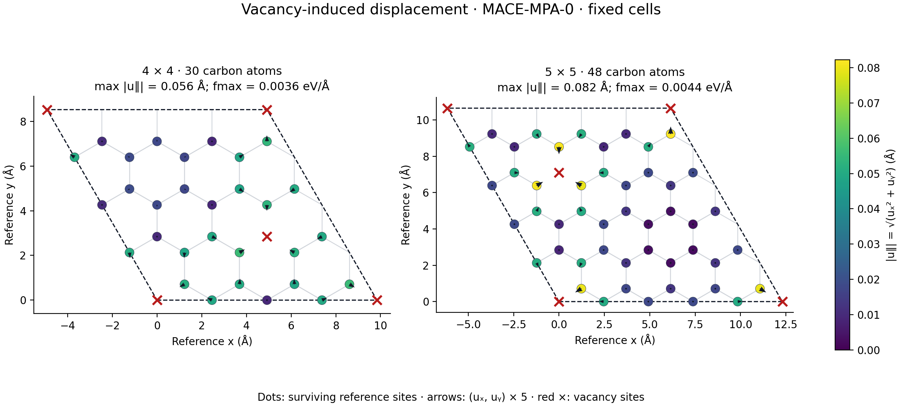
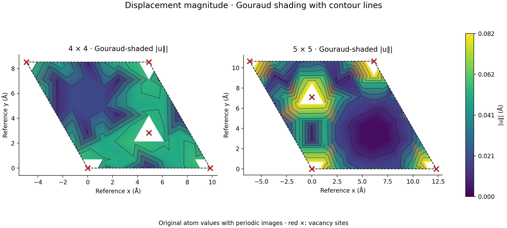
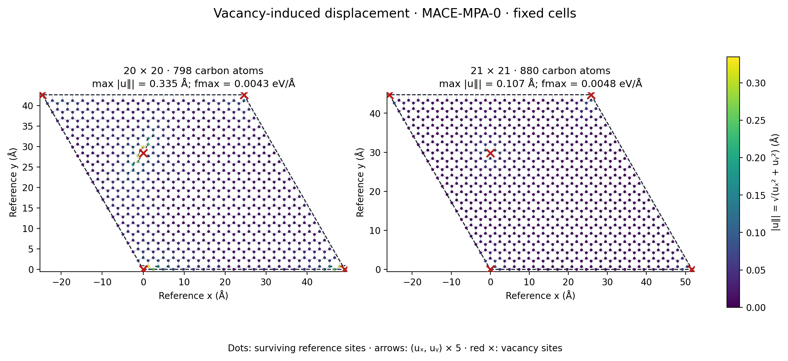
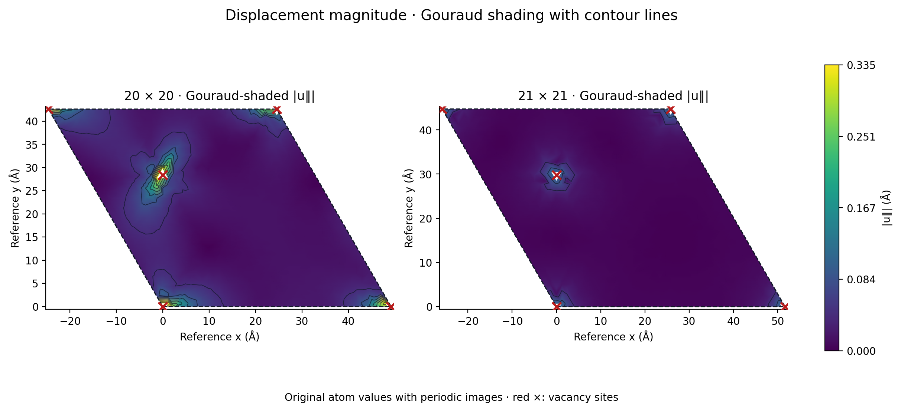

First local result: displacement around two vacancies forming a honeycomb vacancy
superlattice in periodic 4 × 4 and 5 × 5 graphene cells.

## Intended figure

The cells were held fixed at $a=2.46$ Å while atoms relaxed in 3D with MACE-MPA-0
medium. Colour shows $|\mathbf{u}_{\parallel}|=\sqrt{u_x^2+u_y^2}$ at surviving
reference sites. Arrows show $(u_x,u_y)$ magnified by five; red crosses mark
vacancies and their boundary images. Both panels use the same colour scale.

The largest in-plane displacements are 0.055897 Å (4 × 4) and 0.082216 Å (5 × 5).
Both final maximum forces are below 0.005 eV/Å. These are exploratory
foundation-model results; no strain tensor has been inferred.

## Data and analysis

Displacement is the periodic minimum-image difference between relaxed and ideal
surviving-site positions, after removing rigid translation. The random starting
perturbation is excluded from the reference. See the
[calculations page](../calculations/calculations.qmd) and
[plotting script](../calculations/02_vacancy_relaxation/plot_displacement.py).

The second view uses Matplotlib `tripcolor` with `shading="gouraud"`, applied to
the original atom magnitudes on a triangulation including periodic images.
Black `tricontour` lines show constant-magnitude contours. Both cells use the same
colour scale as the vector figure; triangles containing missing sites are masked.
The CSV files retain all three displacement components for later strain analysis.

## Larger cells: calculation 03

The [03 calculation set](../calculations/03_vacancy_relaxation_20_21/README.md)
uses the same checkpoint and physical/numerical relaxation settings as the small
cells. Both reached a maximum force below 0.005 eV/Å. The maximum in-plane
displacements are 0.334622 Å (20 × 20) and 0.106652 Å (21 × 21).

Both vacancy lattices have equal nearest distances in three 120° directions.
The 20 × 20 vacancies occupy opposite parent carbon sublattices, while the exact
21 × 21 pattern occupies the same sublattice. The 20 × 20 run reconstructs a close
neighbour pair at each vacancy; the force-converged 21 × 21 run retains an
approximately threefold local arrangement. These differences accompany the
change in cell size. Gouraud colour and contour lines use the original atomic
magnitudes, and both panels share one colour scale.

## Formation-energy scan: calculation 04

The [04 calculation set](../calculations/04_vacancy_formation_energy_2_10/README.md)
uses $E_\mathrm{form}=E_\mathrm{defect}-(2n^2-2)\mu_\mathrm{C}$, with
$\mu_\mathrm{C}$ from the perfect two-carbon primitive unit cell at matching
fixed lattice constant. The main axis reports the total energy of both
vacancies; the right axis reports the average per vacancy. Marker shapes
identify the parent sublattices. All nine cells are force-converged, and the
connecting line is a guide to the eye.

The 7 × 7 through 10 × 10 values span 13.8076–13.8368 eV for two vacancies.
These are single-start local relaxations with changing vacancy concentration
and sublattice arrangement; global-minimum reconstruction and dilute-limit
convergence remain to be checked.

## Caption draft

**Vacancy-induced displacement in graphene.** Two vacancies per periodic cell
form a honeycomb vacancy superlattice. Atomic structures are relaxed with
MACE-MPA-0 medium at fixed cell vectors. In-plane displacement is measured from
the ideal surviving-site positions after removing rigid translation. Colour
encodes displacement magnitude and arrows show displacement direction at fivefold
magnification. The 4 × 4 and 5 × 5 cells contain 30 and 48 carbon atoms, respectively.
Maximum residual forces are 0.003587 and 0.004394 eV/Å.
