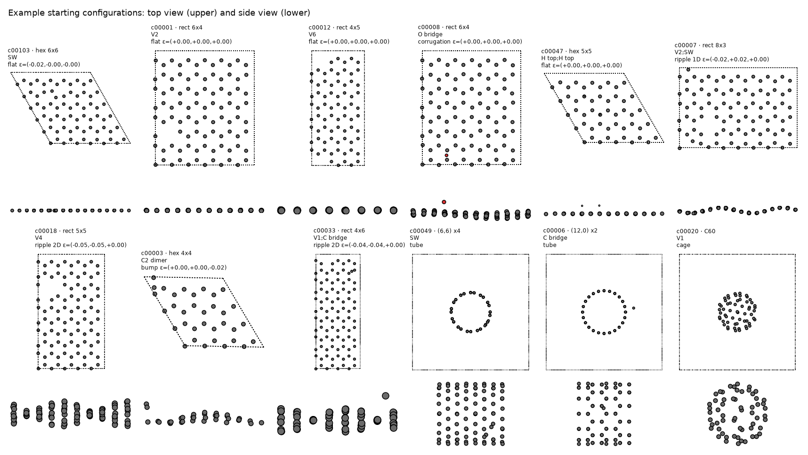

`build_configs.py` builds 1,300 starting configurations. Each one combines a
carbon framework, point defects, strain and curvature, then displaces every atom
by a small Gaussian amount (standard deviation 0.01–0.05 Å). Every structure has
at most 100 atoms and is periodic in all three directions, with at least 12 Å of
vacuum between periodic images, so the structures can be labelled directly by a
plane-wave code. Relaxation and MD can shift atoms slightly: the smallest gap
in the selected sheet frames is 11.8 Å.

## Frameworks

- Graphene sheets (78 %): hexagonal $n \times n$ cells with $n = 4$–7 (32–98
  atoms), or rectangular cells of 4-atom orthogonal units, 64–100 atoms, with
  $x$ along the zigzag direction and $y$ along the armchair direction. The cell
  height is 20 Å, raised where curvature needs more room.
- Nanotubes (15 %): armchair (3,3), (4,4), (5,5), (6,6), (7,7) and zigzag (8,0),
  (9,0), (10,0), (12,0), 64–96 atoms, periodic along the axis.
- C60 (7 %) in a 22 Å cubic cell.

## Defects

Defects are placed on the undeformed framework, at least 5 Å apart where the
cell allows. The sheet menu is:

- vacancies: V1, V2 (two bonded atoms), V3 and V4 (random connected clusters),
  V6 (one hexagon), V1 + V1, V2 + V1;
- Stone–Wales (SW): one bond rotated by 90° about its midpoint; SW + SW;
- adatoms: C (bridge, top or hollow), H (top), O (bridge or top), N (bridge,
  top or hollow), F (top), at typical bonding heights with 0.1 Å noise; a
  quarter sit below the sheet;
- adatom pairs, H pairs on neighbouring sites, and a C2 dimer above a hexagon;
- Frenkel pairs (V1 with a C adatom 2–5 Å away) and decorated vacancies (H, O,
  N or F above a vacancy);
- combinations: SW + V1, SW + adatom, V1 + adatom, and V2 with a rotated bond
  next to it, which relaxes towards 555-777-type reconstructions.

The H, N, O and F adatoms, the H pairs and the decorated vacancies were not
meant to be part of the set. Their frames go through relaxation, MD and the
committee evaluation, but the selection (step 5) drops them, so the final set
is pure carbon.

Clusters of three or more vacancies only go into cells with at least 64 atoms
and at least 9.5 Å in both directions. Nanotubes take V1, V2, SW, adatoms,
V1 + adatom and SW + V1, with Stone–Wales rotations about the local surface
normal. C60 takes V1, V2, SW and adatoms.

## Strain

Sheets get an in-plane small-strain tensor $\varepsilon$, applied as
$F = I + \varepsilon$ to the cell and atoms:

- none (25 %);
- uniaxial (25 %): along the zigzag direction, the armchair direction or a
  random angle, mostly tensile up to +15 %, sometimes compressive to −3 %;
- biaxial (20 %): equal, −3 % to +10 %, or unequal, −2 % to +10 %;
- shear (12 %): up to ±8 %;
- general (18 %): random symmetric tensor, components −4 % to +8 %.

Nanotubes get axial strain from −3 % to +12 % in 70 % of cases, and an
elliptical cross-section (up to 15 %) in 40 %. C60 gets isotropic scaling of
±3 % and a squash of up to 8 % along one axis.

## Curvature

Sheets get one out-of-plane shape:

- flat (35 %);
- 1D ripple (25 %): $z = A \sin(2\pi k s)$ along one cell direction, $k = 1$ or
  2, with compression $\varepsilon_c$ = 1–8 % along that direction and
  $A = L\sqrt{\varepsilon_c}/(\pi k) \times$ 0.8–1.2, so that the ripple's arc
  length roughly matches the uncompressed length;
- 2D ripple (12 %): product of sines along both directions with biaxial
  compression of 1–5 %;
- bump (13 %): a Gaussian of height 0.5–2 Å and width 2.5–4.5 Å, up or down;
- corrugation (15 %): three random Fourier modes compatible with the cell, each
  up to 0.3 Å.

## Composition


