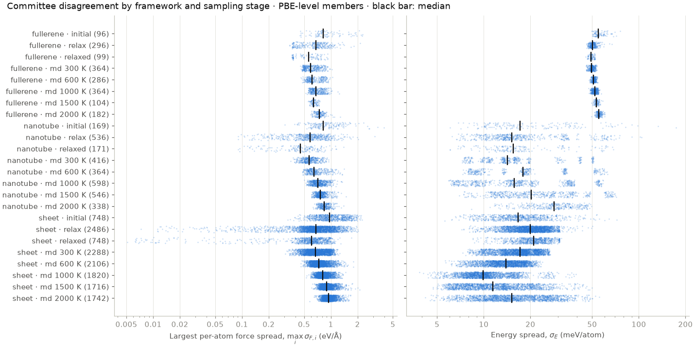
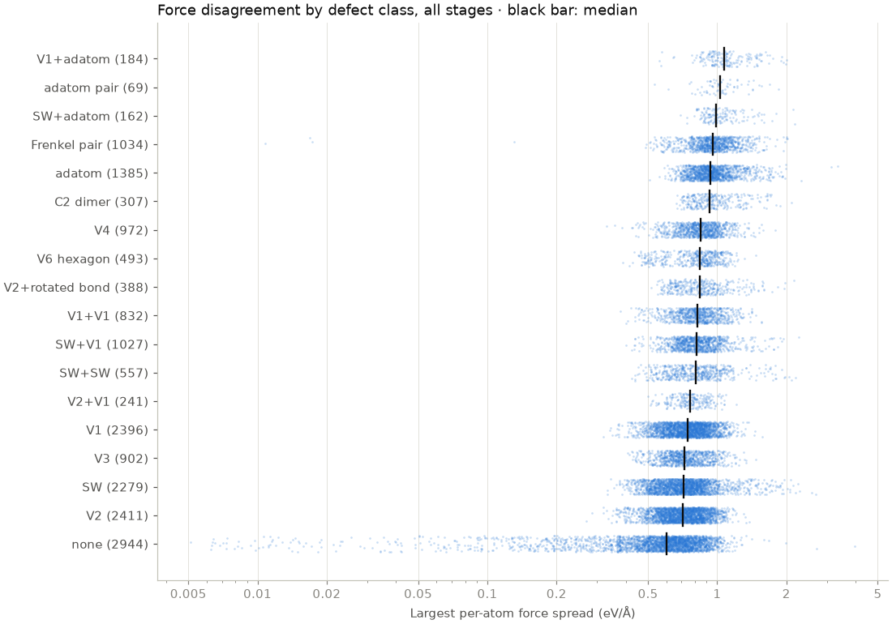
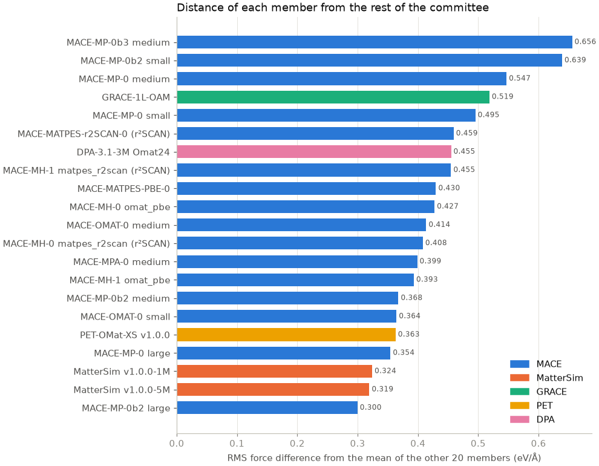

`evaluate.py` computes energies and forces for every candidate frame with all 21
members in float32. Before the run, the batched results were checked against the
members' ASE calculators on test frames, and they agreed to within
$6\times10^{-6}$ eV/atom and $2\times10^{-5}$ eV/Å.

## How the evaluation ran

| Members | Device | Batching | Wall time |
|---|---|---|---:|
| 16 MACE configurations | GPU | Shared batches of up to 3,000 atoms: each batch's graph is built once, with a 6 Å cutoff, and passed through all 16 models | 2 h 58 min |
| MatterSim 1M, 5M | CPU, 4 threads | MatterSim data loader, up to 1,000 atoms | 47 and 100 min |
| PET-OMat-XS | CPU, 4 threads | One frame at a time | 29 min |
| GRACE-1L-OAM | CPU, 4 threads | One frame at a time | 61 min |
| DPA-3.1-3M | GPU | Frames of equal atom count together, up to 3,000 atoms | 22 min |

Building each graph once for all MACE members saves 15 of every 16 neighbour
list constructions. The 5 Å models (MP-0b2) give zero weight to edges beyond
their cutoff; on a 1,336-frame test pool, the shared batches matched separate
per-model evaluations to $6\times10^{-6}$ eV/atom. A batch that runs out of GPU
memory is split in half and retried.

To keep the GPU load moderate, only one process used the GPU at a time, each was
limited to half the GPU memory, and after each batch the process paused for as
long as the batch had taken. In spot checks the GPU averaged about 140 W of its
250 W limit and stayed below 70 °C. MatterSim, PET and GRACE ran on the CPU in
parallel with the MACE run instead of queueing for the GPU.

## Disagreement measures

For each frame, with $M = 18$ PBE-level members, member forces
$\mathbf{F}_{m,i}$ and committee mean $\bar{\mathbf{F}}_i$:

$$
\sigma_{F,i} = \Big(\frac{1}{M}\sum_m \lvert \mathbf{F}_{m,i} - \bar{\mathbf{F}}_i \rvert^2\Big)^{1/2},
\qquad
\sigma_{F} = \max_i \sigma_{F,i}.
$$

Members do not share an energy zero, so each member's energies are first
corrected by its own elemental reference energies, $\mu_{m,Z}$, fitted by least
squares over the scored frames. Since these are pure carbon, this reduces to
one reference energy per member, $\mu_{m,\mathrm{C}}$. The energy spread is then

$$
\sigma_E = \operatorname{std}_m \frac{E_m - \sum_Z n_Z \mu_{m,Z}}{N}
$$

in eV/atom. The same quantities over all 21 members are stored alongside.

## Results



