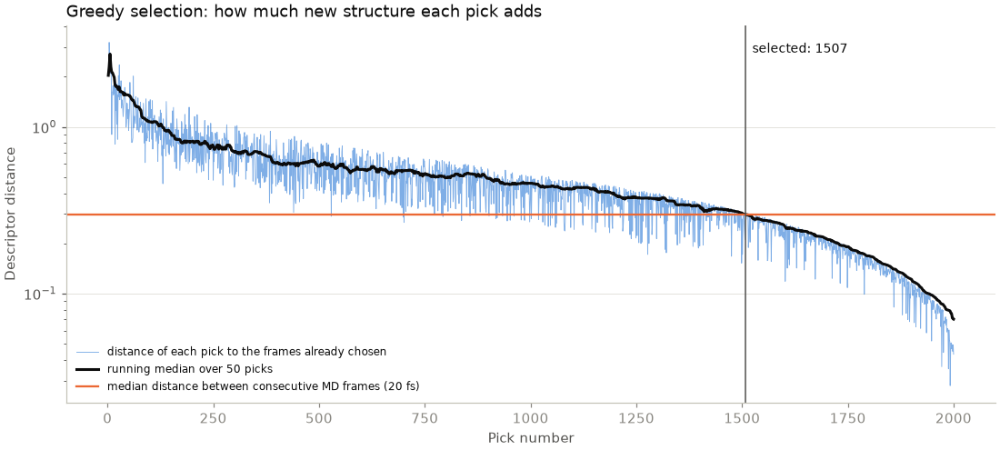
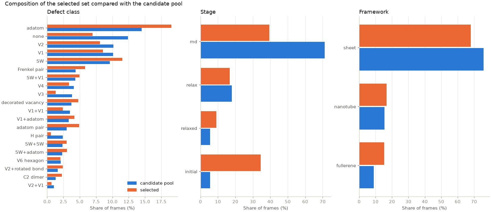
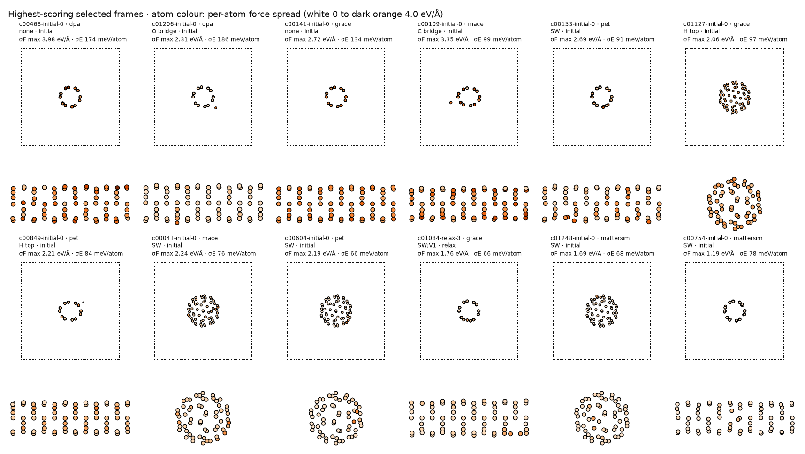

`select_frames.py` reduces the candidate pool to the frames where the committee
disagrees most, while keeping the set structurally diverse.

## Score

Each frame's score adds its two disagreement measures from step 4, each divided
by its median over the pool:

$$
s = \frac{\sigma_F}{\operatorname{median}(\sigma_F)} + \frac{\sigma_E}{\operatorname{median}(\sigma_E)}.
$$

Frames in the top 40 % by score form the selection pool.

## Diversity

The highest-scoring frames tend to come in runs of similar MD snapshots from
one trajectory, so ranking by score alone would fill the set with near-copies.
The selection therefore picks greedily in descriptor space. Each frame's
descriptor joins its mean MACE-MPA-0 invariant atomic descriptor with the
descriptor of its most uncertain atom (a fixed 64-dimensional random projection
of the 256 invariant features), each component standardised over the pool.
Starting from the highest-scoring frame, each step adds the frame that maximises

$$
d_\text{min} \times \frac{s}{s_\text{max}},
$$

where $d_\text{min}$ is its distance to the nearest frame already chosen. Each
starting configuration contributes at most three frames: one unrelaxed frame
(the starting structure or a relaxation step), one relaxed minimum and two MD
frames.

## Number of frames

As the selection grows, each new pick lies closer to frames already chosen.
The selection stops where the running median (over 50 picks) of that distance
falls to the median distance between consecutive saved MD frames of one
trajectory, which are 20 fs apart. Beyond that point, new picks resemble each
other about as closely as neighbouring MD snapshots do. The count is kept
between 1,000 and 2,000 frames.





## Output file

`finetune_set/finetune_selected.extxyz` holds the selected frames in extended
XYZ format, with positions, cell and periodic boundary conditions. Each frame
carries its metadata in the comment line:

- origin: `frame_id`, `config_id`, `framework`, `framework_detail`,
  `defect_class`, `defects`, the strain and curvature parameters, `stage`,
  `step`, `generator` and, for MD frames, `md_temperature_K`;
- disagreement: `committee_force_std_max`, `committee_force_std_mean`,
  `committee_energy_std_per_atom`, the same quantities including the r²SCAN
  members, `selection_score` and `selection_order`;
- per-atom arrays: `committee_force_std` and `committee_mean_forces`, the mean
  of the 18 PBE-level members.

The file contains no `energy` or `forces` entries. The committee values are for
selection only; the frames need reference labels, for example from PBE single
points, before fine-tuning. The scores of every candidate frame are in
`candidate_scores.csv.gz`.
