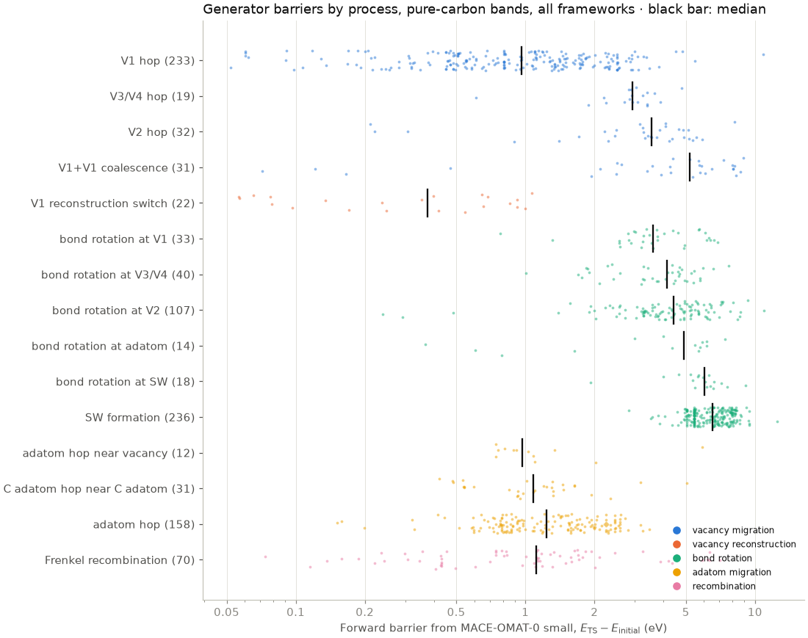
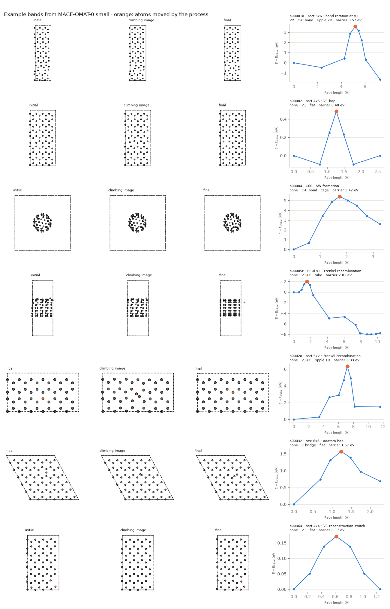

`ts/neb.py` relaxes the end states and runs a climbing-image NEB for every pair
with one model, MACE-OMAT-0 small.

## Generator model

All bands come from MACE-OMAT-0 small (8.2 million parameters, trained on
OMat24). It is the fastest MACE member on this machine, about 22,000 atoms per
second for energies and forces in batches. Among the committee members it sits
closer to the committee consensus than MACE-MPA-0 (leave-one-out RMS force
difference 0.364 against 0.399 eV/Å on the pure-carbon frames of the first
set). OMat24 includes rattled
and high-temperature structures, which are closer to transition states than the
near-equilibrium structures of MPtrj. The paths and barriers are therefore those
of one model. The committee in step 3 measures how much the other models
disagree on them.

## Batched relaxation and NEB

Each end state and each band keeps its own ASE optimiser. At every optimiser
step, the structures that need forces (all unconverged end states, or the
interior images of all running bands) are evaluated together in batches of up
to 2,500 atoms. The results go back to each optimiser through a
`SinglePointCalculator`. One GPU process runs at a time. It may use half of the
GPU memory, and after each batch it pauses for half the batch's run time. The
CPU builds the next batch's neighbour graph during the pause.

TorchScript normally re-profiles the model for every new batch shape. That cost
about 0.4 s per call here, because almost every batch differs, so the profiling
executor is switched off. This doubled the throughput. `evaluate.py` now does
the same for the committee's MACE members.

## Settings

| Setting | Value |
|---|---|
| End-state relaxation | FIRE, $f_\text{max} = 0.05$ eV/Å, at most 500 steps, cell fixed |
| NEB | ASE `NEB`, improved tangent, spring constant 0.1 eV/Ų, IDPP interpolation |
| Optimiser | FIRE, time step 0.1, maximum step 0.1 Å |
| Climbing image | switched on once the largest NEB force is below 0.5 eV/Å |
| Convergence | largest NEB force on any image below 0.05 eV/Å with the climbing image on; 0.1 eV/Å accepted at the 600-step limit |
| Images | 5 interior images for hops and the reconstruction switch, 7 for bond rotations and recombinations; reruns use $2n+1$, at most 13 |

## Checks and corrections

After the end states relax, a pair is dropped if either state did not converge
or has close contacts or a detached atom, or if the moving atoms ended less
than 0.5 Å apart (0.15 Å for the reconstruction switch). A pair is also dropped
if atoms more than 6 Å from the event moved by more than 1 Å between the two
states. That happens when a ripple shifts or flips during one of the two
relaxations.

Bond rotations start from a band in which the rotating pair is pushed out of the
surface by 0.3–0.7 Å at the middle image, both atoms to the same side or to
opposite sides. Without this push, an in-plane path stays in-plane by symmetry.
Every interior image gets a 0.01 Å random displacement.

A test run on 50 bands showed three problems, each with a correction:

- **Rigid drift.** The NEB projections can leave a net force or torque on an
  image. A sheet image can slide in its plane, and a tube or cage image can also
  rotate. Bands drifted by up to 3 Å and then broke apart. The NEB forces now
  have the net translation removed from every image, and the net rotation about
  the tube axis (nanotubes) or about all axes (C60).
- **Runaway climbing images.** Where the band resolves a barrier poorly, the
  image energies jump, for example from 0.6 to 6 eV between neighbouring images.
  The climbing image then keeps moving uphill along a poor tangent, in tests to
  20–170 eV. A band now stops when its highest image rises more than 2 eV above
  its energy at the start of climbing, or when an atom moves more than 1.5 Å
  between neighbouring images. Such a band is rerun from the same end states
  with about twice as many images. Bands that do not reach the climbing stage
  within 300 steps are also rerun.
- **States below both end states.** About a quarter of the test bands found
  structures well below both end states. This happens when the end states are
  shallow minima, for example an unrelaxed divacancy next to a rotated bond. A
  band now stops once an interior image lies 0.3 eV below both end states. Its
  lowest image is then relaxed, and the next round runs two bands, one from the
  initial state to this intermediate minimum and one from it to the final state.

Follow-up bands get the parent's `pair_id` with `r` (rerun), `a` (first half)
or `b` (second half) appended, and at most two rounds of follow-ups are run.

A converged band without a barrier, where the climbing image is less than
0.02 eV above the higher end state, describes a downhill path. It is recorded,
but it gives no transition state.

## Results

The run took 5 h 22 min: 28 min for the 4,000 end-state relaxations and the
rest for three NEB rounds of 1,750, 792 and 208 bands. The GPU was busy for
2 h 41 min of that time, at about 22,200 atoms per second, and the job used at
most 3.5 GB of memory. Of the 2,000 pairs, 1,750 kept usable end states, and
1,381 gave at least one converged band with a barrier. Counting follow-up
bands, 1,432 bands converged with a barrier. 376 of these contain an H, N, O or
F adatom and are dropped in the next step, which leaves 1,056 pure-carbon bands.
The tables below count every band that ran; the figures show the pure-carbon
bands only.

Process names describe how each pair was built. In some bands the end-state
relaxation changed the defect, so the band connects two minima through a saddle
point but does not follow the named process. For example, p00028 starts from a
Frenkel pair whose adatom had already bonded into the lattice during the
relaxation, and its final state lies 1.5 eV above the initial one. Recombination
should release energy, and 4 of the 37 pure-carbon Frenkel recombination bands
on sheets end higher than they start. The reaction energies of the other
processes match expectations. SW formation on sheets costs a median 4.5 eV, and
85 % of V1 hops on sheets end within 0.3 eV of their start, as the symmetry of
the process requires.

MACE-OMAT-0 small gives a median barrier of 0.87 eV for the 59 carbon adatom
hops on flat sheets. On the same geometries, the median over the 18 PBE-level
members is 0.33 eV, and only MACE-MP-0 medium (0.95 eV) gives a value as high
as the generator. Published DFT values are about 0.4–0.5 eV. The generator is
therefore an outlier for this process, and the adatom hop paths are its paths.
DFT forces on these climbing images will show how far they are from DFT saddle
points.



