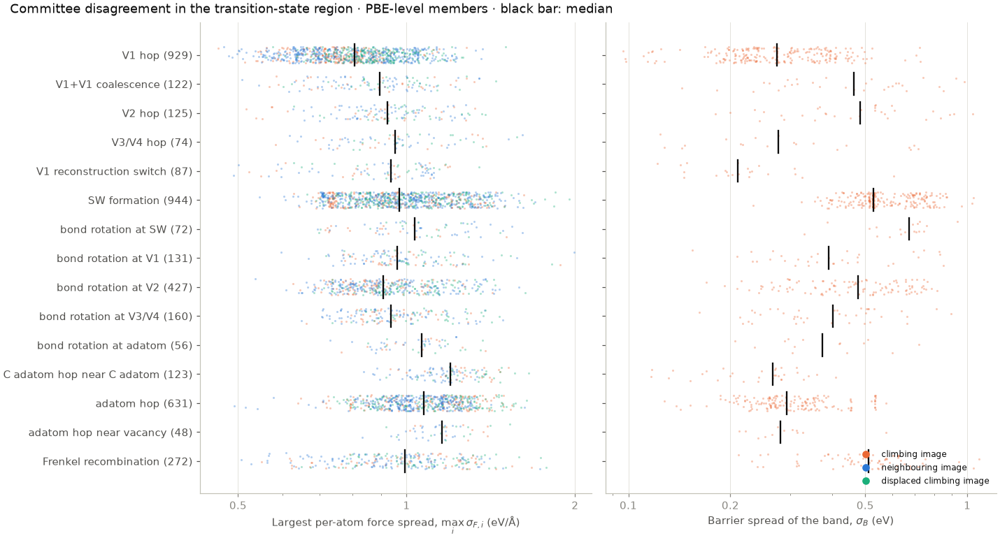
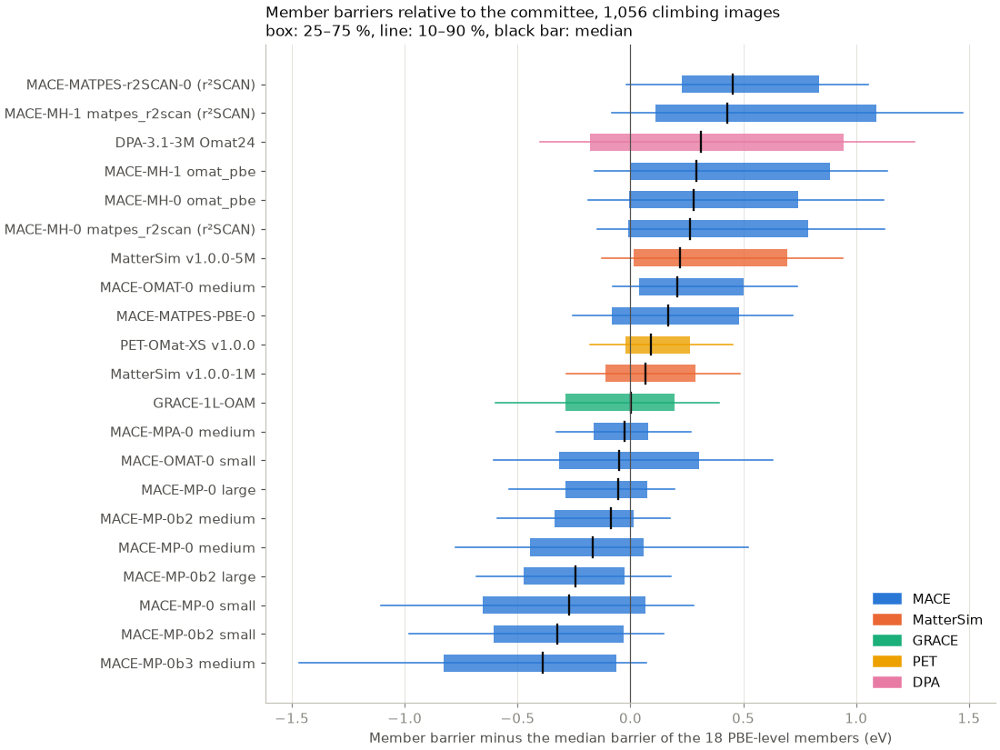

`ts/assemble.py` collects the transition-state region of every band that
converged with a barrier. `evaluate.py` from the first set then computes
energies and forces for these frames with the same 21 committee members.

## Candidate frames

Each usable band contributes:

- the climbing image (`ts`);
- the images on either side of it (`ts_neighbour`), if they are interior images;
- one copy of the climbing image with every atom displaced by a Gaussian of
  standard deviation 0.02–0.05 Å (`ts_displaced`), which samples the saddle
  region away from the path;
- the two end states (`initial`, `final`). The committee evaluates them so that
  each member's barrier can be computed. They are not candidates for selection,
  because the first set already covers relaxed minima.

Frames with close contacts or detached atoms are dropped.

## How the evaluation ran

`ts/run_committee.sh` runs the members in the same arrangement as for the first
set. The 16 MACE members run on shared GPU batches, followed by DPA-3.1-3M on the
GPU. MatterSim, GRACE and PET run on the CPU at the same time. MACE now runs with
the TorchScript profiling executor switched off (see [TS 2](02_neb.qmd)).



## Disagreement measures

The force spread is the same as in the first set. With $M = 18$ PBE-level
members, member forces $\mathbf{F}_{m,i}$ and committee mean
$\bar{\mathbf{F}}_i$:

$$
\sigma_{F,i} = \Big(\frac{1}{M}\sum_m \lvert \mathbf{F}_{m,i} - \bar{\mathbf{F}}_i \rvert^2\Big)^{1/2},
\qquad
\sigma_{F} = \max_i \sigma_{F,i}.
$$

The energy measure is a barrier spread, one value per band. Each member's
energy for the climbing image is taken relative to the mean of its own energies
for the band's two end states, and the spread over members is

$$
\sigma_B = \operatorname{std}_m \Big[ E_m^\text{TS} - \tfrac{1}{2}\big(E_m^\text{initial} + E_m^\text{final}\big) \Big]
$$

in eV. The end states contain the same atoms as the climbing image, so this
difference needs no elemental reference energies, unlike the per-atom energy
spread of the first set. $\sigma_B$ is the spread of the members' mean of
forward and backward barriers along the generator's path. Every frame of a band
carries the band's $\sigma_B$.

The same spread can be computed for each neighbouring or displaced image, and
`candidate_scores.csv.gz` stores it as `relative_energy_std`. It is not used in
the score. For the displaced copies, its median is 0.81 eV against 0.39 eV for
the climbing images. The random displacement raises every member's energy by a
few eV, and the softer members raise it less, so this spread mostly measures
the members' stiffness against the displacement. A first version of the
selection used each frame's own spread, and 429 of its 500 frames were displaced
copies. Each member's
forward barrier on that path, $E_m^\text{TS} - E_m^\text{initial}$, is stored
in `barriers.csv.gz`. These barriers are measured on MACE-OMAT-0 small's
geometries. They are not each member's own barrier, which would need an NEB
with that member.

## Results



