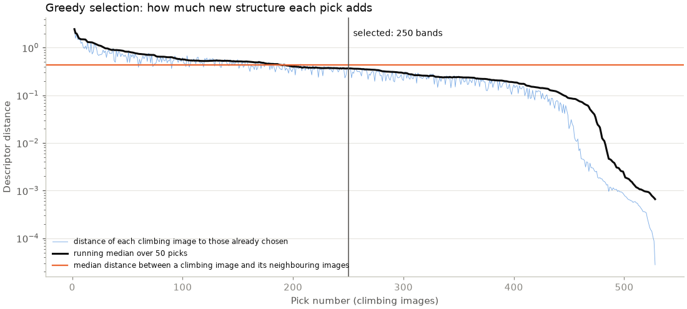
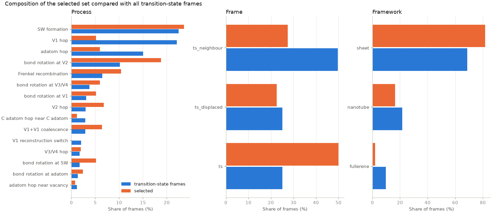
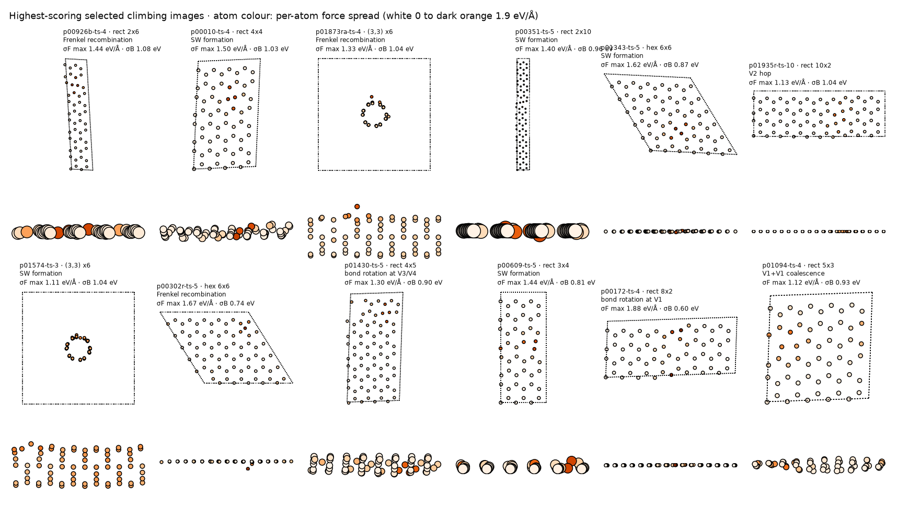

`ts/select_ts.py` reduces the transition-state frames to those where the
committee disagrees most, while keeping the set structurally diverse. It
reuses the greedy search of the first set ([step 5](../../steps/05_selection.qmd)).

## Score

Each transition-state frame's score adds its force spread and barrier spread
from TS 3, each divided by its median over all transition-state frames:

$$
s = \frac{\sigma_F}{\operatorname{median}(\sigma_F)} + \frac{\sigma_B}{\operatorname{median}(\sigma_B)}.
$$

Frames in the top 50 % by score form the selection pool.

## Diversity and limits per band

The descriptor is the same as in the first set. It joins each frame's mean
MACE-MPA-0 invariant atomic descriptor with the descriptor of its most
uncertain atom, standardised over the transition-state frames. Starting from the
highest-scoring frame, each step adds the frame that maximises
$d_\text{min} \times s / s_\text{max}$, where $d_\text{min}$ is the distance to
the nearest frame already chosen. Each band contributes at most two frames: its
climbing image and one neighbouring or displaced image.

## Number of frames

The selection stops where the running median (over 50 picks) of $d_\text{min}$
falls to the median distance between a climbing image and its neighbouring
images on the same band. Beyond that point, new picks resemble each other about
as closely as adjacent images of one band do. The count is kept between 500 and
1,000 frames.





## Output files

`finetune_set/ts/finetune_ts_selected.extxyz` holds the selected frames, with
positions, cell and periodic boundary conditions. Each frame carries its
metadata in the comment line:

- origin: `frame_id`, `pair_id` (band), `parent` and `generation` for follow-up
  bands, `process`, `process_class`, `framework`, `framework_detail`,
  `context` (a defect present before the process), `detail` (the moving atom or
  bond), `event_atoms`, the strain and curvature parameters, `stage`
  (`ts`, `ts_neighbour` or `ts_displaced`) and `image`;
- generator: `generator_energy`, `barrier_forward`, `barrier_backward`,
  `neb_status` and `neb_fmax` from MACE-OMAT-0 small;
- disagreement: `committee_force_std_max`, `committee_force_std_mean`,
  `committee_barrier_std`, `committee_barrier_mean`, the same spreads including
  the r²SCAN members, `selection_score` and `selection_order`;
- per-atom arrays: `committee_force_std`, and `committee_mean_forces`, the mean
  of the 18 PBE-level members.

As with the first set, the file contains no reference energies or forces. The
frames need DFT labels before fine-tuning.

`finetune_set/ts/ts_endpoints.extxyz` holds the relaxed end states of every band
that contributes a selected frame. With these end states labelled as well, the
DFT barrier on the generator's path can be compared with the fine-tuned model's
barrier. Labelling them is optional, because the first set already contains
relaxed minima.
